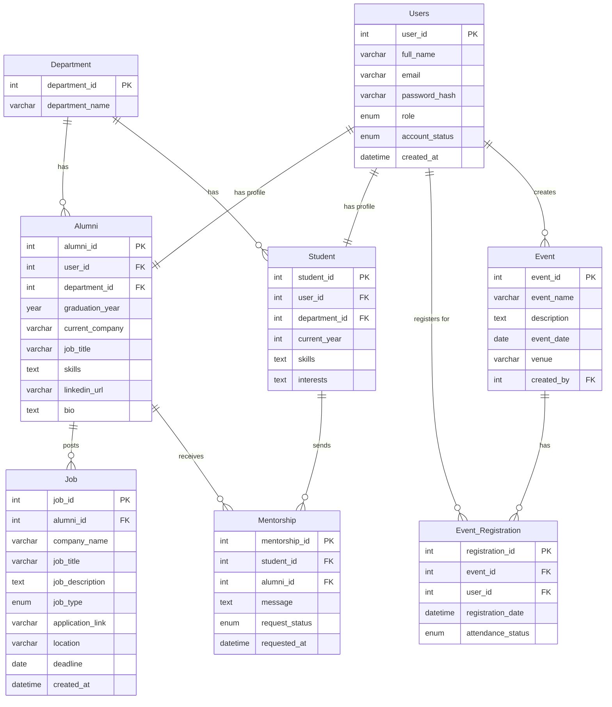

# ER Diagram – Alumni Networking Management System

## Entity-Relationship Diagram (Mermaid)

## Relationships and Cardinalities

| Relationship | Type | Description |
|---|---|---|
| Department → Alumni | One-to-Many | One department has many alumni |
| Department → Student | One-to-Many | One department has many students |
| Users → Alumni | One-to-One | Each user has at most one alumni profile |
| Users → Student | One-to-One | Each user has at most one student profile |
| Alumni → Job | One-to-Many | One alumnus can post many jobs |
| Student → Mentorship | One-to-Many | One student can send many mentorship requests |
| Alumni → Mentorship | One-to-Many | One alumnus can receive many mentorship requests |
| Event → Event_Registration | One-to-Many | One event has many registrations |
| Users → Event_Registration | One-to-Many | One user can register for many events |
| Users → Event | One-to-Many | Admin/alumni can create multiple events |

## Notes

- The **UNIQUE constraint on (event_id, user_id)** in `Event_Registration` enforces that a user can register for each event only once, making it a proper junction table for a many-to-many relationship between Users and Events.
- The **UNIQUE constraint on (student_id, alumni_id)** in `Mentorship` ensures a student can only send one request to each alumnus.
- `Users` is the central authentication table; role-specific data is stored in `Alumni` or `Student` linked by `user_id`.
